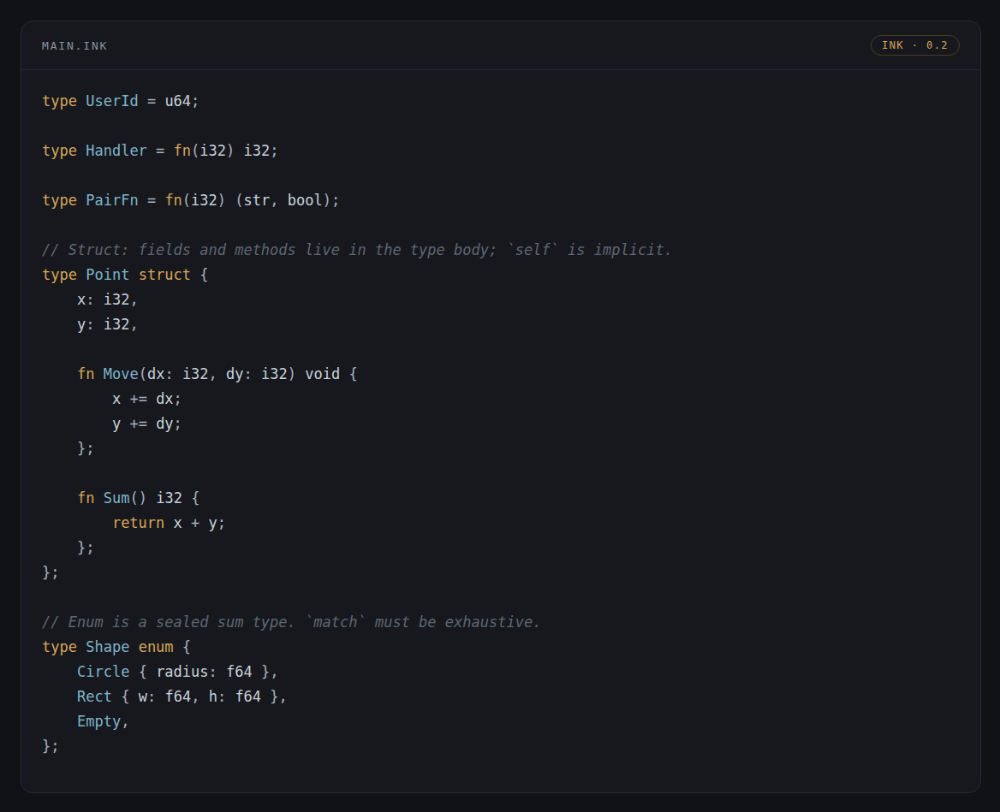

# Ink

Ink is a small application language with Go's runtime and ecosystem:
Go-speed binaries, Hare-like syntax, sum types, and structured parallelism.



```hare
use fmt;

type User struct {
    Name: str,
    age: u32,

    fn Greet() str {
        return "hi, " + Name;
    };
};

fn main() void or error {
    var u = User { Name = "Alice", age = 30 };
    fmt.Println(u.Greet()) or return;
};
```

## Install

Requires Go 1.27+.

```sh
go install github.com/bongdo/ink/cmd/ink@v0.2.0
```

From a checkout:

```sh
./bin/build
export PATH="$PWD/bin:$PATH"
```

## Quick start

```sh
ink new hello
cd hello
ink run
ink build
ink test
```

`ink new` also writes a short `AGENTS.md`, an `opencode.json` that starts
`ink lsp` for `.ink` and formats on edit, and the `ink` OpenCode skill.
`ink guide` prints the full embedded reference, and `ink init` adds the
short guide to an existing directory without overwriting a file that is already
there.

## Status

The 0.2 preview compiler, formatter and language server work end to end for the
implemented surface. The conformance suite in `tests/cases` covers structs,
enums, generics, errors, multiple results, type patterns, `defer`, `match`,
local packages, Go interop, hidden context wrappers and the `par` core (G1–G9:
panic recovery, per-worker `defer`/`within`, map/pointer/alias write rules,
C-style capture). `bin/check` runs it with the unit and LSP tests.

App code has one canonical way per intent. Ink does not add a second spelling
for the same thing, and Go stays an external library at the FFI boundary.

`ink check` type-checks the generated Go through `internal/typecheck` and
reports errors at `.ink` positions for the whole project, including `test`
blocks. `--fast` stops after parse, resolve and sema; full `check` is the
completion gate. `--json` prints one array with 1-based positions, stable
`code`/`hint` fields and `[]` when clean; it exits 1 on errors. Parser and lexer
ends are exact token ends, while sema and typecheck diagnostics end one
character after the start. The LSP publishes the same diagnostics on change
with a debounced typecheck; it is a convenience, not the source of truth. Sema
also checks interface conformance (method sets) for Ink and Go interfaces.

Priority 1 is agent readiness, not 1.0: the roadmap is in
[`design/AGENT.md`](design/AGENT.md), the short workflow is
[`AGENTS.md`](AGENTS.md), and the full reference is `ink guide`. Known limits are in
[`design/GAPS.md`](design/GAPS.md): statement-level `or`; static `par` checks
with `ink run -race` / `ink test -race` as the dynamic oracle (G11); lost
context across package and function-value boundaries (G10); and LSP references
and rename cover project declarations only, with no rename conflict check.
G10/G11 have annotated snippets in [`examples/limits`](examples/limits/README.md).
Deliberate non-goals (local named functions, generic constraints and enums,
guards, expression-level `or`, user variadics, doc comments) are in
[`design/SPEC.md`](design/SPEC.md) §10. This is a 0.2 preview, not 1.0.

## Commands

| Command | What it does |
|---|---|
| `ink build [-o out] [go build flags]` | translate `.ink` to Go and compile a binary |
| `ink run [-race] [-- args]` | build and run; `-race` builds with Go's race detector |
| `ink check [--json] [--fast] [--race]` | parse, check and type-check without building; `--fast` skips the generated-Go typecheck, `--race` type-checks with Go's `-race` build (compile-time only) |
| `ink test [go test flags]` | run `test` blocks with `go test`; `-race` and other flags pass through |
| `ink fmt [-l] [-w] [--json] [paths]` | canonical formatter; `-l` lists unformatted files, `--json` prints them as an array |
| `ink lsp` | language server on stdio |
| `ink new <dir>` | scaffold a project and install `AGENTS.md` |
| `ink init [dir]` | add `ink.toml` to an existing directory and install `AGENTS.md` if absent |
| `ink guide` | print the embedded agent guide |
| `ink version` | print the version |

## Agent loop

`AGENTS.md` is the short ambient contract. The full syntax, canonical fixes and
concurrency limits are printed by `ink guide`; in this repository they are
also the `ink` OpenCode skill, so they load only when the agent needs them.
From the project root:

```sh
ink check --json --fast   # parse, resolve, sema
ink fmt -w .
ink check --json          # completion gate: generated-Go typecheck
ink test                  # add -race for concurrency
ink run [-- args]         # add -race for the race detector
```

`check --json` prints one array of `file`, `line`, `col`, `endLine`, `endCol`,
`severity`, `code`, `message` and `hint`; positions are 1-based, `[]` means
clean, and the exit code is 1 when any error remains. `fmt -l --json` prints an
array of paths. The full contract, canonical syntax table and diagnostic codes
are in `ink guide`.

## OpenCode

The repository ships `opencode.json`: it starts `ink lsp` for `.ink` and
runs `ink fmt -w $FILE` after edits. Build `bin/ink` first (`bin/build`).
OpenCode attaches LSP errors to `edit`/`write` results, so the agent sees the
feedback without running `check` after every change. Its `lsp` tool adds
definition, references, hover and document/workspace symbols; code actions and
rename remain editor-facing. The `ink` skill carries the
full language reference and loads on demand. Outside this repository, copy the
`opencode.json` snippet and put `ink` on `PATH`. Restart OpenCode after
changing the config; LSP is disabled by default.

## Project layout

```
hello/
  ink.toml         name and Go module path
  main.ink         package main
  AGENTS.md        short agent contract (ink new / ink init)
  opencode.json    OpenCode LSP + formatter (ink new)
  .opencode/skills/ink/SKILL.md  on-demand full guide (ink new)
  lib/             package lib (optional)
    util.ink
```

Local imports use a path:

```hare
use "./lib" as lib;
```

Go imports use a Go import path:

```hare
use fmt;
use "charm.land/bubbletea/v2" as tea;
```

The root package is compiled as `package main`. One directory is one package.
Generated Go lands next to the sources as `zz_ink.go`; the support runtime
is copied to `.ink/runtime`.

## Language

The full specification is in [`design/SPEC.md`](design/SPEC.md). The historical
design snapshot and open questions from v0 are in [`design/SYNTAX.md`](design/SYNTAX.md).
Compiler internals are in [`design/IMPL.md`](design/IMPL.md).

Highlights:

- `var x = value;`, `var p: *Point = nil;`, `const Name = value;`, no `:=`.
  `const` is package-level only and is a compile-time name, not a runtime slot.
- `use fmt;` for simple Go imports; quoted paths for Go imports with `/`
  (e.g. `net/http`, `charm.land/...`) and local `./lib`.
  A versioned Go import path (`/v2`, `/v3`, ...) requires an alias.
- comments are `//` only; block comments are rejected.
- `fn name(a: T) R { ... };`, errors as `T or error`, propagation with `or return`;
  manual `if err != nil { return err; }` is rejected.
- struct literals use named fields only.
- multiple results: `fn f() A, B or error`, `var a, b = f();`,
  `var a, b = f() or return;`; `_` is a result placeholder and explicit discard.
- `type Name struct { ... }`, `type Shape enum { ... }`,
  `type Writer interface { ... }`; alias keeps `=` (`type UserId = u64;`).
  Fields and methods live inside the body, with implicit `self`.
- `type Shape enum { Circle { radius: f64 }, Empty, };` with exhaustive `match`.
- `match` on `any` with `case T as x` and `else`; negative literals and
  `case nil` for nilable values. `break`/`continue` in a case target the loop.
- `T[]`, `T[N]`, `map[K, V]`, `*T`, `fn(A) R`, generics `Stack[T]`.
- `par { ... }`, `par for (...) limit N`, `within 30s { ... }`, no visible `context`.
  `par for` over a map and `for ()` inside `par` are rejected.
- `defer` is block-scoped. Hidden context gets a non-ctx wrapper at Go interfaces.
- `par` workers recover panics, keep their own `defer` stack, and reject unsafe
  map/pointer/alias writes; `ink check` type-checks generated Go.
- `void` is only a function result; value positions are rejected.

## Presentation

`docs/presentation/index.html` — обзор языка, синтаксиса, Bubble Tea и внутренней
кухни. Рядом: `internals.html` (компилятор) и `cheatsheet.html` (шпаргалка).

## Editor support (LSP)

The language server runs over stdio:

```sh
ink lsp
```

It provides diagnostics, hover, go-to-definition, references, rename, code
actions, completion, document/workspace symbols, signature help and formatting.
Diagnostics update on change; the generated-Go typecheck is debounced by 150 ms
and includes `test` blocks. References and rename cover declarations in the
project, not Go library symbols; rename does not check for name conflicts.
`ink check` remains the source of truth for the whole project; the LSP is an
editing convenience.

- Neovim: copy the `vim.lsp.start` setup from [`docs/lsp.md`](docs/lsp.md).
- VS Code: [`editors/vscode`](editors/vscode) has a TextMate grammar and a
  language client. Run `npm install && npm run compile` inside it.
- Any editor with an LSP client can use `ink lsp`.

`ink check` remains the authoritative check: it covers the whole project and
all files, not just the buffer you have open.

## Development

```sh
bin/check     # gofmt, go vet, unit tests, conformance cases
bin/build     # build bin/ink
bin/run help  # run the compiler from source
```

Conformance programs live in [`tests/cases`](tests/cases). Each case has a
`ink.toml`, a `main.ink`, and an `expected.txt`.

## License

MIT. See [LICENSE](LICENSE).
